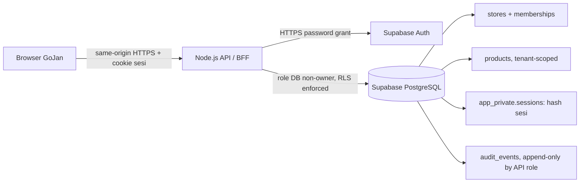

# GoJan — backend Node.js dan Supabase

## Arsitektur



Browser tidak menyimpan token autentikasi atau menjadikan `localStorage` sumber
kebenaran. Node.js memverifikasi login melalui Supabase Auth, membuat token sesi
acak, menyimpan hash token saja, dan mengirim cookie HttpOnly. Role dan `store_id`
selalu ditentukan dari sesi/membership di server. Tidak ada pembayaran di API.

## Menjalankan lokal

1. Buat proyek Supabase dan salin `.env.example` sebagai `.env`.
2. Isi `SUPABASE_URL`, `SUPABASE_ANON_KEY`, dan `DATABASE_URL` dengan nilai proyek.
   Jangan masukkan secret/service-role key ke `.env` bila tidak diperlukan; anon key
   bukan rahasia. `DATABASE_URL` hanya untuk backend dan harus TLS.
3. Sebagai admin database Supabase, buat role runtime `gojan_api` dengan password
   acak kuat, `LOGIN NOBYPASSRLS`, dan tanpa membership ke role `postgres`,
   `anon`, `authenticated`, atau `service_role`. Simpan password hanya pada
   secret manager dan `DATABASE_URL`; jangan commit.
4. Terapkan [migrasi SQL](./server/migrations/001_initial.sql) memakai SQL Editor
   sebagai admin proyek. Migrasi memakai tabel `auth.users` dari Supabase Auth
   dan memberi grants minimum ke role runtime.
5. Buat akun pemilik melalui Supabase Auth (dashboard atau proses provisioning
   tepercaya), lalu buat store dan membership `owner` untuk UUID pengguna tersebut.
   Pendaftaran publik tidak disediakan. Contoh provisioning setelah akun dibuat:

   ```sql
   INSERT INTO stores (slug, name, is_public)
   VALUES ('gojan', 'GoJan', true)
   ON CONFLICT (slug) DO UPDATE SET is_public = EXCLUDED.is_public;

   INSERT INTO memberships (store_id, user_id, role)
   SELECT id, 'REPLACE_WITH_AUTH_USER_UUID'::uuid, 'owner'
   FROM stores WHERE slug = 'gojan'
   ON CONFLICT (store_id, user_id) DO UPDATE SET role = 'owner', is_active = true;
   ```

6. Jangan jalankan API memakai `postgres`, pemilik tabel, atau service-role key.
   Startup API memeriksa bahwa role bukan superuser/BYPASSRLS dan semua tabel
   tenant memakai FORCE RLS.
7. `npm run dev` menjalankan Node API dan Vite pada `APP_ORIGIN` yang sama.
   `npm test` menjalankan tes; `npm run build` membuat aset frontend.

Produksi wajib HTTPS. Set `NODE_ENV=production`, `APP_ORIGIN` ke origin HTTPS yang
tepat, dan jalankan `npm run build` sebelum server; cookie produksi memakai
`HttpOnly; Secure; SameSite=Lax`. Password hanya diteruskan ke Supabase Auth,
tidak disimpan atau dicatat. API tidak pernah mengirim access/refresh token ke
browser. Logout mencabut sesi server. Sesi berlaku 8 jam dan setelah habis perlu
login lagi.

Jalankan produksi dengan `npm run build` lalu `npm start`; proses Node menyajikan
aset build dan API pada origin yang sama. Tempatkan TLS di load balancer tepercaya
atau gunakan HTTPS langsung.

## API

- `GET /api/products` — hanya produk publik pada `PUBLIC_STORE_SLUG`.
- `POST /api/auth/login`, `GET /api/auth/me`, `POST /api/auth/logout` — sesi cookie.
- `/api/owner/products` — CRUD sesuai role `owner`/`editor`; setiap query dibatasi
  pada toko dari membership akun.
- `POST /api/owner/import` — impor maksimum 100 produk, khusus role `owner`.
  ID lama dipakai sebagai kunci idempotensi; ID server baru dibuat oleh PostgreSQL.
- `/owner.html` menyediakan login Supabase nyata dan peninjauan/impor data
  localStorage dari browser yang sama. Tidak ada akun demo atau login sisi client.

Endpoint perubahan memeriksa `Origin`, menerima JSON terbatas, memvalidasi dan
menormalisasi input di server, serta menggunakan parameter query. Operasi mutasi
dan audit log berada dalam transaksi. `viewer` hanya dapat membaca katalog milik
toko; role tidak pernah dipercaya dari request browser.

## Impor data localStorage

Impor tidak berjalan otomatis dan tidak menganggap seed contoh sebagai data pemilik.
Pemilik login di `/owner.html`, meninjau daftar pada perangkat yang sama, lalu
menekan konfirmasi untuk mengirimnya ke `POST /api/owner/import`. Bentuk payload:

```json
{
  "products": [
    {
      "id": "p01",
      "nama": "Contoh produk",
      "kategori": "Makanan",
      "harga": 10000,
      "stok": 5,
      "deskripsi": "",
      "imageUrl": "",
      "unggulan": false
    }
  ]
}
```

Server memvalidasi seluruh batch sebelum transaksi, mengabaikan ID sebagai ID
database, menyimpannya sebagai `legacy_id`, dan melewati ID yang pernah diimpor.
Simpan cadangan lokal sampai pemilik memeriksa data hasil impor.

## RLS dan audit

RLS aktif dan `FORCE` pada stores, memberships, products, dan audit_events.
API membuka transaksi tenant dan memasang `app.user_id` secara lokal pada
transaksi; policy menggabungkan identitas itu dengan membership dan role. Public
read dibatasi pada store/produk yang dipublikasikan. Kredensial runtime harus role
non-owner `NOBYPASSRLS`; memakai role Supabase `postgres` atau service-role akan
melewati jaminan RLS dan ditolak saat startup. Koneksi per request memakai
parameterized SQL, dan konteks tenant tidak bertahan setelah transaksi.

Audit merekam aktor, toko, aksi, entity, request ID, dan perubahan produk tanpa
password/token. Role runtime hanya mendapat `INSERT`/`SELECT` audit, bukan
`UPDATE`/`DELETE`; batasi akses audit pada owner.
